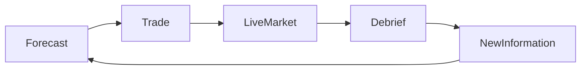

# StockTroder Game Theory

## 1. Purpose

This document explains the strategic theory behind StockTroder. It connects the current mechanics to game theory and to useful board-game patterns.

The goal is not to make StockTroder financially realistic. The goal is to create decisions that are:

- Understandable.
- Risky without being arbitrary.
- Difficult to solve with one obvious strategy.
- Interesting under time pressure.
- Strong enough to support future multiplayer.

The key design question is:

> Does the player have a meaningful choice between several actions, with enough information to reason about the risk but not enough information to know the answer?

## 2. Current Strategic Model

The player starts with £1,000 and trades six fictional stocks across ten rounds. Each round has:

- A forecast before trading starts.
- A 30-second live market.
- Price samples about twice per second.
- Buy and sell actions during the round.
- A debrief after the round.
- A player-controlled transition to the next round.

The player is not choosing only which stock to buy. The player is also choosing:

- How much cash to keep.
- How long to hold a position.
- Whether to trade during a price movement or wait.
- Whether to trust a forecast.
- Whether to use the Pump action.
- Whether to use the debrief to plan or to act quickly.

This creates a repeated decision game rather than one large investment decision.

## 3. Game Theory Concepts in StockTroder

### 3.1 Expected value

A player estimates the possible outcomes of an action and weighs them by their chance of occurring.

For a simple trade:

```text
expected profit = probability of price increase * possible gain
                  - probability of price decrease * possible loss
```

The player does not need exact probabilities. The forecast range, stock personality, live graph, and news should provide enough evidence for a rough estimate.

The game should avoid making the forecast perfectly accurate. If the forecast always wins, the best strategy becomes obvious. If the forecast has no value, the player is only guessing.

### 3.2 Expected utility and risk preference

Two players can see the same expected return and choose different actions.

- A risk-seeking player may buy Frontier Biotech before a large possible movement.
- A risk-averse player may hold Harbor Foods and preserve cash.
- A cautious player may sell early when a small profit is available.

This is useful because the game does not need one correct strategy. It needs several strategies with different risk profiles.

A player's utility is also affected by the current run state. A player who is already £1,000 ahead may value protecting that lead more than chasing another £1,000.

### 3.3 Opportunity cost

Cash used in one stock cannot be used in another stock or saved for a later opportunity.

A buy action has at least three costs:

- The money spent on the shares.
- The risk of the chosen stock falling.
- The lost chance to act on another stock.

Pump makes opportunity cost visible because it spends £25 without directly buying an asset.

### 3.4 Information asymmetry

The game gives the player information, but not certainty:

- The projection gives a direction and range.
- News explains a possible cause.
- The graph shows recent movement.
- The exact next price is unknown.

This is an information problem. The player asks whether the available evidence is strong enough to justify a trade.

The system must avoid false information. A forecast can be wrong, but it should not feel unrelated to the result. Players should be able to learn from outcomes.

### 3.5 Time preference

The player can take a small gain now or hold for a possible larger gain later.

The 30-second round creates a short time horizon. The player must decide whether to:

- Enter early and wait.
- Trade during momentum.
- Take profit before the round ends.
- Hold through the final resolution.

The debrief adds a second time decision. The player can pause to study the result, but cannot change the completed round.

### 3.6 Risk of ruin

A strategy that can produce large profits but removes the player's ability to act after one loss may be strategically poor.

StockTroder should protect the player from total ruin in Phase 1:

- No margin.
- No debt.
- No short selling.
- No stock below £1.00.
- Invalid trades do not change state.

The player can lose money, but should retain enough agency to continue making decisions.

## 4. The Game as a Repeated Game

StockTroder is a repeated game with one player against an uncertain market model. Each round changes the information available for the next round.



The player learns:

- Which stocks are more volatile.
- How reliable the projection ranges feel.
- How news affects each stock.
- Whether Pump is worth its cost.
- How much time is needed to make a good decision.

A strong strategy should adapt. If the same action is best in every round, the repeated structure is not doing enough work.

## 5. Pump as a Strategic Action

The current Pump action is a simple asymmetric bet:

- Cost: £25.00.
- Target: one selected stock.
- Limit: once per stock per round.
- Short-term effect: 4% positive live path boost.
- Downside: seeded correction risk at resolution.
- Correction: usually 8%, with a smaller 2% result in the other case.

Pump is not a normal trade. It spends cash to change the shape of the risk.

### Pump decisions

The player must decide:

- Is the target stock already likely to rise?
- Is the 4% boost worth £25?
- Can the player sell before the correction?
- Is the cash better used to buy shares?
- Is the player willing to accept a bad final resolution?

### Pump requirements

Pump should remain balanced by the following rules:

- It must never be a guaranteed profit.
- Its cost must be visible before activation.
- The stock target must be visible.
- Its use must be limited.
- The correction must be explainable in the debrief.
- A player should be able to win without using it.

### Pump and agency

The action is interesting only if the player can respond to it. If Pump changes the price in a way that cannot be traded around, it is just a random event. If Pump always creates a safe exit, it becomes a dominant strategy.

The live graph and the 30-second window give the player agency, but the correction risk prevents certainty.

## 6. Dominant Strategies and Balance Warnings

A dominant strategy is an action that is better than every alternative in almost every situation. Dominant strategies reduce the game to button selection.

Watch for these problems:

### Always buy the same stock

Cause:

- One stock has a higher average return without enough added risk.

Response:

- Increase its volatility.
- Reduce its forecast reliability.
- Give other stocks useful defensive roles.

### Always hold until the end

Cause:

- Live selling has no advantage.
- The final resolution is too predictable.

Response:

- Give the player useful intraround momentum.
- Make forecasts ranges rather than exact targets.
- Add meaningful correction or reversal risk.

### Always sell immediately

Cause:

- Prices rise early and then always reverse.

Response:

- Vary the shape of live paths.
- Make some movements continue and some movements fade.

### Always Pump

Cause:

- The boost is worth more than the cost and correction risk.

Response:

- Increase the cost.
- Reduce the boost.
- Increase correction risk.
- Limit Pump more strictly.
- Improve normal trading opportunities instead of only weakening Pump.

### Never Pump

Cause:

- The cost is too high or the correction is too severe.

Response:

- Give the player a reason to use it during selected situations.
- Allow a strong player to reduce risk through timing, not certainty.

## 7. Board-Game Comparisons

StockTroder should borrow mechanisms, not copy a specific game.

### 7.1 Auction games: valuation under incomplete information

Examples include *For Sale*, *Modern Art*, and *Power Grid*.

Useful lessons:

- Money has value beyond the current purchase.
- A player must estimate what an opportunity is worth.
- The best action depends on what other opportunities remain.
- Visible information can still produce different valuations.

StockTroder application:

- Cash should remain useful across the whole run.
- Pump cost should compete with buying shares.
- Forecast ranges should support different valuations.

Future multiplayer application:

- Players could compete for limited influence over a stock.
- The value of a Pump could rise if several players want the same target.
- A player could spend resources to deny an opponent an opportunity.

### 7.2 Push-your-luck games: stop or continue

Examples include *Incan Gold* and *Can't Stop*.

Useful lessons:

- The decision to stop is often more important than the decision to start.
- A small guaranteed gain can be valuable.
- Players need clear signals about increasing danger.

StockTroder application:

- Selling during a live round is the stop decision.
- Holding through a strong movement is the push decision.
- A correction warning or volatile graph can communicate rising danger.
- The player should understand what is at risk before continuing.

The debrief is different from a push-your-luck stop decision. It happens after the outcome and should support planning, not add another hidden gamble.

### 7.3 Engine-building games: small advantages over repeated rounds

Examples include *Terraforming Mars* and *Wingspan*.

Useful lessons:

- Repeated small advantages can become meaningful.
- A player needs time to see an investment pay off.
- An engine should create choices, not remove them.

StockTroder application:

- A successful early round gives more capital for later rounds.
- More capital increases possible trades, but does not guarantee success.
- Pump should not become an engine that funds itself without risk.

### 7.4 Hidden-information games: reading signals

Examples include *Coup* and *Skull*.

Useful lessons:

- Players need partial information and reasons to doubt it.
- Signals should be readable but not conclusive.
- Bluffing is interesting only when the cost of being wrong matters.

Single-player StockTroder application:

- News and projections act as signals from the market model.
- The player compares signals against price movement.
- The uncertainty comes from the simulation rather than another human bluffing.

Multiplayer application:

- A player could choose whether to reveal or conceal a manipulation action.
- Public actions could change the market's expectations.
- Any hidden information must be communicated clearly and remain fair.

### 7.5 Area control and majority: influence has a target

Examples include *Acquire* and *El Grande*.

Useful lessons:

- A resource becomes more interesting when it must be assigned to a target.
- Timing and concentration can matter more than total resource count.
- Competing players create pressure around valuable targets.

StockTroder application:

- Pump already has a target stock.
- Future influence resources could be limited per round.
- Multiplayer could turn stock manipulation into a contest for market attention.

### 7.6 Tableau and portfolio building: balance a set

Examples include *Splendor* and *Bohnanza*.

Useful lessons:

- Players should make tradeoffs between a focused plan and a flexible plan.
- A collection of different assets can protect against one bad result.
- Concentration should offer greater reward with greater risk.

StockTroder application:

- Holding several stocks is diversification.
- Holding one volatile stock is concentration.
- Defensive stocks should have lower movement but reduce the chance of a catastrophic round.

## 8. What StockTroder Should Learn from Board Games

### 8.1 Make the resource loop visible

Board games make resources easy to count. StockTroder should clearly show:

- Cash remaining.
- Value invested.
- Current portfolio value.
- Pump cost.
- Round profit or loss.
- Total run profit or loss.

### 8.2 Give every resource multiple uses

Cash should support:

- Buying shares.
- Preserving flexibility.
- Paying for Pump.
- Recovering after a loss.

If cash has only one useful action, the economy has little strategy.

### 8.3 Create tension without hiding the rules

The outcome can be uncertain, but the rules should be clear. The player should know:

- What the forecast means.
- What Pump changes.
- What the correction risk is.
- When the round ends.
- When trading is unavailable.

### 8.4 Give players meaningful recovery

A bad round should hurt but not end the run. Later rounds should offer ways to recover through good decisions, not random gifts.

### 8.5 Keep the board state legible

Board games succeed when players can scan the table. StockTroder should make the current market state readable within seconds:

- Price.
- Direction.
- Projection.
- Shares.
- Action buttons.
- Time remaining.

## 9. Single-Player Versus Multiplayer Theory

### Single-player

The market model is the opponent. The main challenge is uncertainty, timing, and learning the model.

The game should avoid pretending that the player is competing against other players. A strong single-player score can measure:

- Final return.
- Round consistency.
- Best trade.
- Risk taken.
- Pump efficiency.

### Multiplayer

Other players create strategic interaction that the current prototype does not have:

- A player's trade may affect another player's opportunity.
- A Pump may move a shared market.
- Public actions create information.
- Players can deny, follow, or punish a strategy.

The multiplayer game should not simply expose the single-player simulation to several clients. It needs a clear answer to:

> What can one player do that changes another player's best decision?

Possible answers include:

- Shared stock prices.
- Limited manipulation capacity.
- Auctions for influence.
- Public news and private actions.
- A fixed number of portfolio slots.

Until this answer is clear, multiplayer would add connectivity without adding game theory.

## 10. Theory-Based Balance Tests

Use these questions during playtesting:

- Can a cautious player make progress without Pump?
- Can a risky player gain more without having a guaranteed path to victory?
- Does holding cash remain a valid choice?
- Is selling early sometimes better than waiting?
- Are forecasts useful but fallible?
- Does Pump create a new decision or simply increase the best stock's value?
- Can a player recover after a bad round?
- Can a player explain why a trade succeeded or failed?
- Does the debrief improve the next decision?
- Do different stock personalities lead to different strategies?

A useful playtest should record decisions, not only final profit. A player who wins by accident may not have found a good strategy.

## 11. Design Position

StockTroder is best understood as:

> A real-time, short-horizon portfolio game with forecast uncertainty, push-your-luck timing, and a limited market-manipulation resource.

It is not yet a full economic simulation or a multiplayer negotiation game. Those can come later if the current decision loop proves that players enjoy reading the market, choosing risk, and living with the result.

## 12. Choosing the Numbers

### 12.1 What theory can and cannot tell us

Game theory does not tell us that the player should start with £1,000, that Pump should cost £25, or that a planted news story should cost a particular amount. Those are design parameters.

Theory can tell us what to ask about the parameters:

- What actions are available?
- What information does the player have?
- What outcomes can each action produce?
- What does each outcome cost or reward?
- Does one action dominate the others?
- Does the player have a reason to preserve options?

The values should be chosen to create the intended decision structure, then tested with real players and simulation. A number is justified when it creates a useful choice, not because it resembles a real financial value.

### 12.2 Use normalized units before pounds

Balance should be reasoned about in percentages before it is expressed in pounds.

For the current prototype:

```text
starting cash = 100 budget units
Pump cost = 2.5 budget units
Pump cost as cash = £25 on a £1,000 start
```

This makes later changes easier. If the starting cash becomes £500, the Pump cost can remain 2.5% rather than becoming an unrelated new number.

The starting amount should be large enough to support several meaningful purchases, but small enough that cash remains scarce. The current stock prices give the player different levels of exposure to each stock. That is useful, but the real test is whether the player must choose between concentration, diversification, Pump, and holding cash.

### 12.3 A practical cost model

Use the player's starting cash and the normal round movement as the reference points:

```text
action_cost = starting_cash * cost_percent
action_value = position_value * expected_effect_percent
```

An action is interesting when its value is plausible but not certain. For example, Pump should be compared with the profit from buying shares, not with the full £1,000 bankroll.

For every paid action, record:

- Cash cost as a percentage of starting cash.
- Expected price effect.
- Worst plausible effect.
- How quickly the player can respond.
- Whether the action consumes another opportunity.

Initial tuning bands, not permanent rules:

| Action | Starting test band | Design reason |
| --- | ---: | --- |
| Pump | 1% to 4% of starting cash | Large enough to compete with buying shares, small enough to remain usable |
| Sabotage | 2% to 6% of starting cash | Stronger because it targets a negative outcome and may need detection risk |
| Plant news | 2% to 5% of starting cash | Pays for information influence rather than direct price control |
| Ordinary round movement | 3% to 10% | Large enough to create decisions during a 30-second round |

These bands are starting hypotheses. They must be checked against observed player behavior and simulated outcomes.

### 12.4 How to test a cost

For Pump, compare three choices in the same market state:

```text
A: buy shares normally
B: spend the money on Pump
C: keep the cash
```

Run each choice over many seeds. Measure:

- Mean final return.
- Median final return.
- Worst 10% of outcomes.
- Frequency of losing money.
- Cash remaining after the round.
- How often the player would choose each option.

The goal is not to make A, B, and C equally profitable. The goal is to make each one correct in some situations and dangerous in others.

### 12.5 News-story pricing

Planting a news story should not be priced by the size of the text or by a real-world advertising budget. It should be priced by the strategic leverage it gives the player.

Before implementing it, define:

- Does the story affect one stock or the whole market?
- Does it change the forecast, the live path, the final resolution, or only what the player knows?
- Is the story public, private, true, false, or uncertain?
- Can the player profit before the market reacts?
- Can the story fail or create a backlash?

If the action changes both information and price, it may be too powerful. A safer first version would change the weighting of the next news event while leaving the player uncertain about the result. The player then pays for influence, not certainty.

## 13. Source Notes

These sources support the framework, not the exact StockTroder values.

### Game theory and decision theory

- Don Ross, “Game Theory,” *Stanford Encyclopedia of Philosophy*. Covers utility, strategic interaction, imperfect information, sequential games, repeated games, commitment, and behavioral evidence: <https://plato.stanford.edu/entries/game-theory/>.
- R. A. Briggs, “Normative Theories of Rational Choice: Expected Utility,” *Stanford Encyclopedia of Philosophy*. Covers expected utility, probabilities, outcome value, risk, bounded rationality, and the limits of expected-value reasoning: <https://plato.stanford.edu/entries/rationality-normative-utility/>.
- John von Neumann and Oskar Morgenstern, *Theory of Games and Economic Behavior*. Foundational work on utility, strategic games, and economic game theory.
- Colin Camerer, *Behavioral Game Theory: Experiments in Strategic Interaction*. Useful for the gap between ideal rational play and how people actually learn and choose.
- Reinhard Selten, “Re-examination of the Perfectness Concept for Equilibrium Points in Extensive Games.” Useful background for the idea that players may make mistakes and that fragile strategies should not be treated as certain.

### Game design and systems

- Robin Hunicke, Marc LeBlanc, and Robert Zubek, “MDA: A Formal Approach to Game Design and Game Research.” The Mechanics-Dynamics-Aesthetics framework is useful for tracing how a cost or probability creates player behavior and experience: <https://users.cs.northwestern.edu/~hunicke/MDA.pdf>.
- Katie Salen and Eric Zimmerman, *Rules of Play: Game Design Fundamentals*. Useful for formal rules, meaningful play, uncertainty, and the relationship between rules and player experience.
- Ernest Adams, *Fundamentals of Game Design*. Useful for practical economy, feedback, pacing, and playtesting methods.

### Board-game examples

The board games in this document are comparisons of mechanisms, not evidence that StockTroder should copy their numbers. Their value is comparative:

- *For Sale*: valuation and cash discipline.
- *Modern Art*: auctions and changing estimates of value.
- *Power Grid*: money, turn order, scarcity, and future opportunity cost.
- *Incan Gold*: push-your-luck decisions and the value of stopping.
- *Can't Stop*: escalating risk and visible commitment.
- *Terraforming Mars* and *Wingspan*: repeated advantages and engine-building.
- *Coup* and *Skull*: partial information, signaling, and the cost of being wrong.

The design team should cite the original rulebooks or publisher pages when making a specific claim about one of these games. The comparisons here are design references, not academic evidence.
